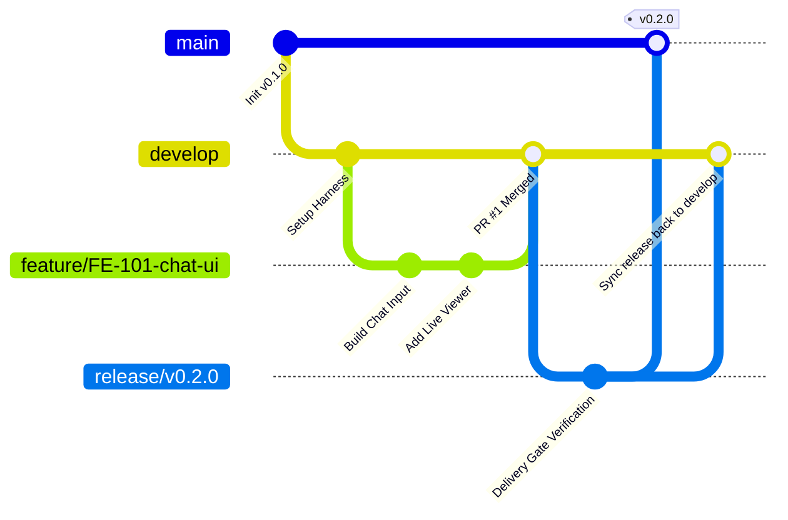

# Git Branching Strategy: main - release - develop - feature

Tenduck 프로젝트의 GitFlow 기반 브랜치 관리 및 릴리즈 전략 명세서입니다.
PO와 FE가 안정적으로 기획, 개발, 검증, 배포 라이프사이클을 통제하기 위해 이 표준을 따릅니다.

---

## 1. 브랜치 계층 구조 및 역할



| 브랜치 분류 | 네이밍 규칙 | 베이스 브랜치 | 머지 타겟 | 설명 | 보호 정책 (Protected) |
| :--- | :--- | :--- | :--- | :--- | :--- |
| **main** | `main` | - | - | 상용(Production) 배포 브랜치. 태그(`vX.Y.Z`)만 존재 | **직접 커밋 금지**, PR 및 승인 필수 |
| **release** | `release/vX.Y.Z` | `develop` | `main` & `develop` | 배포 전 QA 검증, 최종 Delivery Gate 통과, 릴리즈 노트 작성 | 릴리즈 안정화 후 main 태깅 머지 |
| **develop** | `develop` | `main` | `main` (via release) | 일상 개발의 중심 통합 브랜치 | 기본 작업 브랜치, PR 머지 권장 |
| **feature** | `feature/<task-name>` | `develop` | `develop` | 개별 신규 기능, UI 개선, 훅 개발 브랜치 | 작업 완료 후 `develop`으로 PR |
| **hotfix** | `hotfix/<issue-name>` | `main` | `main` & `develop` | 상용 긴급 장애 대응 패치 | 긴급 수정 후 즉시 양쪽 동기화 |

---

## 2. 하네스 3단계와 브랜치 라이프사이클의 연계

1. **[기획 단계]**:
   - PO가 티켓 발급 및 `specs/PRD_TEMPLATE.md`, `specs/LLM_WEBSOCKET_CONTRACT.md` 작성.
   - 개발자는 `develop` 브랜치에서 새 브랜치 생성:
     ```bash
     git checkout develop
     git pull origin develop
     git checkout -b feature/llm-websocket-live
     ```

2. **[개발 단계]**:
   - `anti-slop` 룰 준수 하에 기능 및 고성능 훅 구현.
   - 로컬 커밋은 명확한 Conventional Commits 규약 준수 (`feat:`, `fix:`, `refactor:`, `test:`).

3. **[검증 및 릴리즈 단계]**:
   - `develop`에서 `release/vX.Y.Z` 브랜치 생성.
   - 필수 자동화 검증 수행:
     ```bash
     npm run gate   # Delivery Gate: 슬롭 탐지 + TypeScript strict 검사 + 브랜치 검사
     npm run build  # 프로덕션 빌드 무결성 확인
     ```
   - PO 인수 검증 통과 및 `specs/DELIVERY_GATE_REPORT_TEMPLATE.md` 승인 후 `main`으로 머지 및 태깅.

---

## 3. 브랜치 작업 시 주의사항 (Rules)

- **[CRITICAL] `main` 브랜치 직접 커밋 절대 금지**: `main`은 항상 실제 서비스 배포 가능한 상태(Release Candidate 완료본)만을 유지합니다.
- **[CRITICAL] 기능 개발은 반드시 `develop` 기반 `feature/*`에서 진행**: `main`에서 직접 기능 브랜치를 파지 않습니다.
