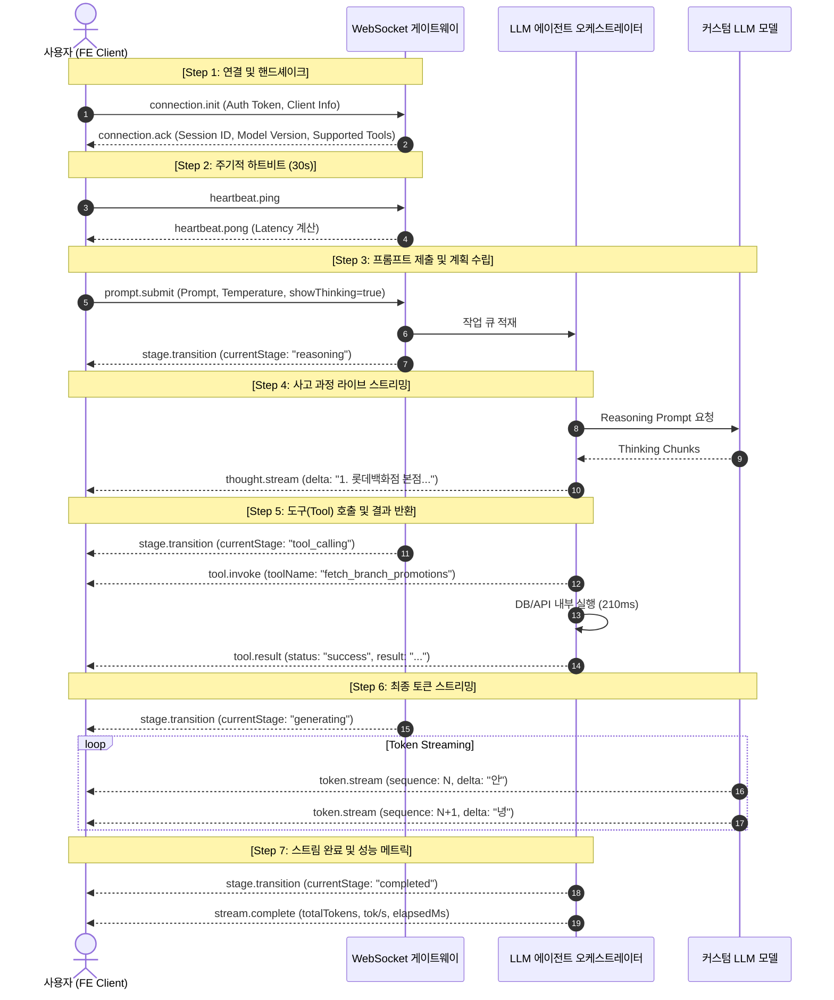

# Custom LLM WebSocket Protocol Contract & Mock Data Specification

Tenduck 클라이언트(PO / FE)와 사내 커스텀 LLM 모델 서빙 백엔드 간의 **실시간 양방향 WebSocket 통신 명세서**입니다.
사고 과정(Chain of Thought), 도구 호출(Tool Calling), 토큰 스트리밍(Token Streaming)의 실사 JSON 패킷 예시를 포함합니다.

---

## 1. 통신 라이프사이클 흐름도



---

## 2. 실사 JSON 목업 데이터 규약 (Raw Mock JSON Payloads)

### [Step 1] 연결 초기화 및 승인

#### ① 클라이언트 발송: `connection.init`
```json
{
  "type": "connection.init",
  "timestamp": 1728730000000,
  "payload": {
    "authToken": "Bearer eyJhbGciOiJIUzI1NiIsInR5cCI6IkpXVCJ9...",
    "clientVersion": "0.1.0",
    "clientId": "client_fe_user_8912"
  }
}
```

#### ② 서버 응답: `connection.ack`
```json
{
  "type": "connection.ack",
  "timestamp": 1728730000050,
  "payload": {
    "sessionId": "sess_lotte_ai_9942a",
    "modelVersion": "lotte-concierge-llm-v2.4",
    "serverTime": 1728730000050,
    "heartbeatIntervalMs": 30000,
    "supportedTools": [
      "query_store_promotions",
      "fetch_avenuel_directory",
      "check_vip_lounge_status",
      "lookup_valet_parking_policy"
    ]
  }
}
```

---

### [Step 2] 프롬프트 제출 (Prompt Submission)

#### 클라이언트 발송: `prompt.submit`
```json
{
  "type": "prompt.submit",
  "requestId": "req_20261012_001",
  "conversationId": "conv_user_abc77",
  "timestamp": 1728730005100,
  "payload": {
    "prompt": "롯데백화점 본점 에비뉴엘 명품관 층별 입점 브랜드와 VIP 라운지 이용 혜택 안내해줘",
    "model": "lotte-concierge-llm-v2.4",
    "temperature": 0.7,
    "maxTokens": 2048,
    "showThinking": true,
    "allowedTools": ["fetch_avenuel_directory", "check_vip_lounge_status"]
  }
}
```

---

### [Step 3] AI 내부 사고 과정 (Reasoning / Thought Stream)

#### ① 단계 전이: `stage.transition`
```json
{
  "type": "stage.transition",
  "requestId": "req_20261012_001",
  "conversationId": "conv_user_abc77",
  "timestamp": 1728730005320,
  "payload": {
    "previousStage": "idle",
    "currentStage": "reasoning",
    "message": "고객 의도 분석 및 백화점 안내 정보 검색 계획 수립 중..."
  }
}
```

#### ② 사고 스트림 청크: `thought.stream` (누적 스트림)
```json
{
  "type": "thought.stream",
  "requestId": "req_20261012_001",
  "conversationId": "conv_user_abc77",
  "timestamp": 1728730005500,
  "payload": {
    "step": 1,
    "topic": "요구사항 분해",
    "delta": "1. 고객 질문: 롯데백화점 본점 에비뉴엘 브랜드 입점 정보 + VIP 라운지 혜택\n2. 먼저 본점 에비뉴엘 디렉토리 도구(fetch_avenuel_directory)를 호출하여 최신 브랜드 정보를 확인해야 함.\n"
  }
}
```

---

### [Step 4] 도구(Tool) 호출 및 실행 결과

#### ① 도구 호출 시작: `tool.invoke`
```json
{
  "type": "tool.invoke",
  "requestId": "req_20261012_001",
  "conversationId": "conv_user_abc77",
  "timestamp": 1728730006200,
  "payload": {
    "toolId": "tool_call_091",
    "toolName": "fetch_avenuel_directory",
    "arguments": {
      "branch": "main_store",
      "targetSection": "avenuel",
      "categories": ["high_jewelry", "luxury_fashion"]
    },
    "timestamp": 1728730006200
  }
}
```

#### ② 도구 실행 완료 및 반환: `tool.result`
```json
{
  "type": "tool.result",
  "requestId": "req_20261012_001",
  "conversationId": "conv_user_abc77",
  "timestamp": 1728730006450,
  "payload": {
    "toolId": "tool_call_091",
    "toolName": "fetch_avenuel_directory",
    "status": "success",
    "result": "본점 에비뉴엘 B1F~6F: 샤넬, 에르메스, 루이비통, 까르띠에, 반클리프 아펠 등 총 64개 럭셔리 부티크 입점 확인 완료",
    "executionMs": 250,
    "timestamp": 1728730006450
  }
}
```

---

### [Step 5] 최종 사용자 텍스트 토큰 스트리밍 (Token Stream)

#### ① 단계 전이: `stage.transition`
```json
{
  "type": "stage.transition",
  "requestId": "req_20261012_001",
  "conversationId": "conv_user_abc77",
  "timestamp": 1728730006700,
  "payload": {
    "previousStage": "tool_calling",
    "currentStage": "generating",
    "message": "안내 답변 생성 중..."
  }
}
```

#### ② 토큰 델타: `token.stream`
```json
{
  "type": "token.stream",
  "requestId": "req_20261012_001",
  "conversationId": "conv_user_abc77",
  "timestamp": 1728730006720,
  "payload": {
    "sequence": 1,
    "delta": "롯데백화점 본점 "
  }
}
```

---

### [Step 6] 완료 및 성능 메트릭 (Completion & Metrics)

#### 서버 응답: `stream.complete`
```json
{
  "type": "stream.complete",
  "requestId": "req_20261012_001",
  "conversationId": "conv_user_abc77",
  "timestamp": 1728730008400,
  "payload": {
    "finalText": "롯데백화점 본점 에비뉴엘은 지하 1층부터 지상 6층까지 샤넬, 루이비통, 에르메스를 비롯한 글로벌 럭셔리 브랜드가 입점해 있습니다...",
    "metrics": {
      "promptTokens": 142,
      "completionTokens": 384,
      "totalTokens": 526,
      "elapsedMs": 1700,
      "timeToFirstTokenMs": 620,
      "tokensPerSec": 45.2,
      "latencyMs": 85
    }
  }
}
```

---

### [Step 7] 에러 처리 (Stream Error)

#### 서버 응답: `stream.error`
```json
{
  "type": "stream.error",
  "requestId": "req_20261012_001",
  "conversationId": "conv_user_abc77",
  "timestamp": 1728730008500,
  "payload": {
    "code": "MODEL_TIMEOUT",
    "message": "커스텀 모델 추론 서버의 응답 시간이 초과되었습니다.",
    "retryable": true
  }
}
```

---

## 3. 에러 코드 분류표

| 에러 코드 (`code`) | 원인 | 복구 정책 (`retryable`) | 클라이언트 권장 액션 |
| :--- | :--- | :--- | :--- |
| `AUTH_FAILED` | JWT 토큰 만료 또는 유효하지 않음 | `false` | 로그인 세션 갱신 팝업 노출 |
| `RATE_LIMIT_EXCEEDED` | 분당 요청 수(RPM) 초과 | `true` | 지수 백오프 후 5초 뒤 재시도 안내 |
| `MODEL_TIMEOUT` | LLM 추론 시간 초과 (30초) | `true` | "다시 시도" 버튼 활성화 |
| `CONTEXT_LENGTH_EXCEEDED` | 대화 히스토리 토큰 한도 초과 | `false` | "새 대화 시작하기" 권장 |
| `TOOL_EXECUTION_ERROR` | 사내 백화점 API 연동 실패 | `true` | 도구 결과 제외 일반 답변 폴백 |
| `INTERNAL_SERVER_ERROR` | 모델 백엔드 장애 | `false` | 관리자 문의 안내 |
